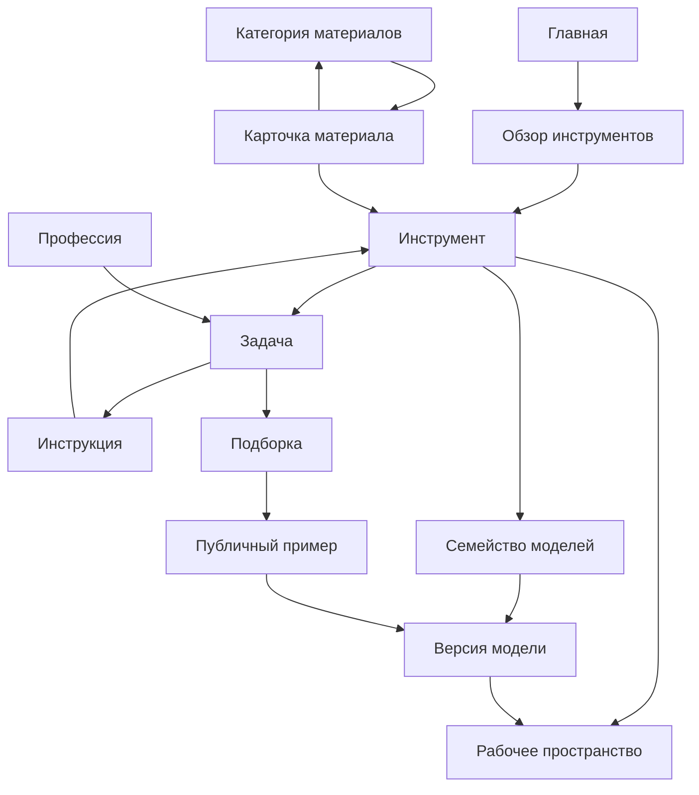

# Шаблоны страниц и данные для SEO структуры Epifera

Статус: проект структуры для разработки и наполнения. Дата: 23 октября 2026 года.

Epifera использует связанные данные об инструментах, моделях, задачах и материалах для сборки публичных страниц. Структура охватывает основные типы страниц английского Magnific и добавляет важные для Epifera направления текста, чатов, музыки и речи. Каталог расширяется по мере появления полезных материалов и доступных функций.

Здесь определены **24 семейства шаблонов**, обязательные данные, источники фактов, связи и условия публикации. Шаблон — повторяемая структура страницы; запись данных — конкретная модель, задача или материал; публичный URL — локализованное представление записи. Это три разных величины.

Машинный каталог структуры: [catalog.json](../../research/epifera-seo-structure/catalog.json). Он содержит описания шаблонов, словарь данных, очередь примеров страниц и правила проверки. Это проектные данные; приложение их сейчас не импортирует.

## Основные решения

1. Расширять существующий слой `src/content`, сохраняя стабильные ID и проверяемые связи. Отдельные локальные сайты и копии приложения не нужны.
2. Использовать английскую структуру Magnific как карту охвата. Текущий контракт Epifera сохраняет `/ru` и `/en`, русский язык по умолчанию и `x-default` на русскую версию. Основной язык сайта этим документом не меняется.
3. Отделить редакционное содержание от серверных фактов о доступности, цене и возможностях модели. Страница модели не даёт модели допуск к запуску.
4. Сначала собирать связные разделы инструментов, моделей, задач и инструкций. Стоковые разделы открывать с собственным каталогом материалов и правами на их распространение.
5. Не создавать автоматически все комбинации модели, задачи, стиля, профессии и языка. Для самостоятельной страницы нужны отличимые содержание, подборка или сценарий.

Рассмотрены три способа организации:

| Подход | Применение | Решение |
| --- | --- | --- |
| Отдельная ручная страница для каждого запроса | Несколько специальных кампаний | Не подходит как основа большого каталога: факты и блоки быстро расходятся |
| Общие шаблоны и связанные записи в существующем репозитории | Первая реализация и проверка модели содержания | Основной подход; использует текущий проверяемый слой данных |
| Система управления содержимым за тем же интерфейсом чтения | Когда редакторов и материалов станет много | Следующий адаптер хранения; не требует переписывать публичные шаблоны |

## Что уже есть в проекте

| Основа | Подтверждённое состояние | Что нужно расширить |
| --- | --- | --- |
| `src/content/domain/schemas.ts` | Сущности model, tool, article; переводы; статусы; автор и проверяющий | Новые сущности, примеры, источники утверждений и типизированные связи |
| `src/content/repository/content-repository.ts` | Серверное чтение по языку и slug, ссылки через стабильные ID | Проекции для новых типов; единый список действительно опубликованных страниц |
| `src/content/data/*` | Примеры: инструмент изображений, GPT Image 2, статья о промптах и черновик | Проверка содержания и прав перед использованием в публичных разделах |
| `src/i18n/seo.ts` | Sitemap содержит только главную для `/ru` и `/en` | Метаданные и sitemap новых реализованных маршрутов |
| `MarketingHome` | Главная и навигационные блоки | Связывать карточки с новыми публичными разделами по мере их публикации |
| Каталог `/web/v1/models` | Общая серверная модель возможностей приложения | Публичная безопасная проекция фактов для посадочных страниц, без данных аккаунта |
| `/app`, `/app/image`, `/app/music`, `/app/speech`, `/app/models` | Маршруты интерфейса | Проверять конкретную операцию, модель и контур; существование маршрута не подтверждает её доступность |

`published` в текущей примерной записи содержания не означает, что соответствующий публичный маршрут уже существует или выложен. В текущем дереве страниц есть публичная главная; шаблоны ниже предстоит реализовать.

## Семейства шаблонов

Пути ниже — проектные примеры для английской локали. Для русской версии используются локализованные slug, в том числе уже записанные в `src/content/data`. Домены берутся из доверенной настройки публичного origin. Родитель в навигации может отличаться от вложенности URL.

| ID | Шаблон | Пример URL | Данные, которые делают страницу самостоятельной |
| --- | --- | --- | --- |
| T01 | Главная | `/en` | Позиционирование, доступные направления, собственные демонстрации, проверенные предложения |
| T02 | Обзор раздела | `/en/ai`, `/en/blog`, `/en/stock`, `/en/academy` | Назначение раздела, отобранные дочерние записи, категории, понятный порядок просмотра |
| T03 | Инструмент | `/en/ai/image-generator` | Входы и результат, доступные операции и модели, примеры, шаги, ограничения, переход к работе |
| T04 | Семейство моделей | `/en/ai/kling` | Список версий, различия, критерии выбора, общие ограничения и примеры |
| T05 | Версия модели | `/en/ai/kling/kling-3-0` | Точный runtime key, проверенные возможности и ограничения, примеры этой версии, отличия от соседних |
| T06 | Решение конкретной задачи | `/en/ai/ai-avatar-generator` | Сценарий, специальные поля, инструкция, подходящие модели, свои примеры и критерии результата |
| T07 | Профессия или отрасль | `/en/ai/marketing` | Рабочие задачи аудитории, последовательности действий, примеры готовых материалов и ограничения |
| T08 | Сравнение | `/en/compare/image-models` | Участники, критерии, одинаковые условия сравнения, результаты или явно описанная документальная методика |
| T09 | Статья | `/en/blog/image-prompt-basics` | Самостоятельный текст, автор, источники, примеры, дата проверки и ссылки на подходящие инструменты |
| T10 | Курс или урок | `/en/academy/courses/image-prompts` | Цель, предварительные знания, программа или содержание урока, упражнение и ожидаемый результат |
| T11 | Документация и помощь | `/en/ai/docs/image-generation` | Проверенный сценарий Epifera, шаги, ограничения, ошибки и способы решения, применимая версия интерфейса |
| T12 | Последовательность действий | `/en/workflows/product-photo` | Шаги и зависимости, входы и выходы, варианты моделей, примеры, режим выполнения |
| T13 | Подборка примеров или промптов | `/en/inspiration/product-photography` | Отобранные публичные примеры, правило подбора, полезное описание, связи с задачами |
| T14 | Публичный пример | `/en/inspiration/examples/studio-cosmetics` | Отдельный разрешённый к публикации результат, модель, параметры, разрешённый промпт, авторство и права |
| T15 | Категория материалов | `/en/photos/aesthetic` | Тематические материалы, воспроизводимое правило выдачи, фильтры и соседние темы |
| T16 | Карточка материала | `/en/stock/items/beige-flowers/ef-0001` | Файл и превью, тип, размеры или длительность, автор, лицензия, разрешённое скачивание, похожие материалы |
| T17 | Интеграция или приложение | `/en/integrations/vk`, `/en/plugins/figma`, `/en/integrations/public-api` | Реальный способ подключения, версия, условия доступа, сценарии, инструкция и проверка работы |
| T18 | Тарифы | `/en/pricing` | Актуальные предложения, единицы оплаты, лимиты, условия, серверный источник цен |
| T19 | Решение для команды или бизнеса | `/en/business`, `/en/enterprise` | Реально доступные функции совместной работы или отдельный прозрачный сценарий обращения |
| T20 | История клиента или проект | `/en/customers/product-campaign` | Подтверждённый кейс, исходная задача, процесс, результаты, согласие на публикацию |
| T21 | Компания и контакты | `/en/company/about-us`, `/en/contact` | Собственные сведения об Epifera, подтверждённые контакты и работающие действия |
| T22 | Событие или специальный проект | `/en/events/creative-workshop` | Дата, организатор, программа, условия участия, текущий статус и материалы после события |
| T23 | Правовой документ | `/en/legal/privacy` | Утверждённый текст, юридический субъект, версия, дата действия, контакты и связанные документы |
| T24 | Автор | `/en/authors/epifera-editorial` | Подтверждённая роль или биография, разрешённые контакты, собственные опубликованные материалы |

У T02 один базовый каркас с вариантами списка инструментов, моделей, статей, курсов, интеграций или материалов. У T16 один договор данных с вариантами отображения медиа. Количество вариантов интерфейса не равно количеству SEO страниц.

## Состав основных страниц

### Инструмент T03

Порядок блоков: хлебные крошки → назначение и основное действие → примеры → доступные модели → инструкция → задачи → ограничения → вопросы → связанные материалы.

Обязательные данные: `operationRefs`, `workspacePath`, перечень входов и выходов, собственные демонстрации, шаги, ограничения, связи с моделями и задачами. На запуске пользователь видит серверную стоимость и отдельно подтверждает платное действие. Посещение страницы, выбор примера и переход в рабочее пространство генерацию не запускают.

Публичный первый экран первоначально может вести в существующий интерфейс. Встроенная форма добавляется только при переиспользовании действующего сценария подготовки и запуска Job. Тексты статьи или рекламной карточки не включают серверные операции.

### Семейство и версия модели T04 и T05

Семейство: назначение → версии → таблица различий → рекомендации по выбору → примеры → переход к генератору. Версия: назначение → свои примеры → характеристики → отличия → ограничения → задачи → вопросы → соседние версии.

Общая таблица сравнения использует одинаковые строки: входные модальности, выходная модальность, операции, форматы, количество файлов, размеры, длительность, разрешение, поддерживаемые настройки, доступность в Epifera и сведения об оплате. Неприменимое поле скрывается; неизвестное помечается как неизвестное. Цифры и версии из Magnific не становятся характеристиками Epifera.

Сравниваются `provider capability`, `implemented in Epifera`, `allowed in this contour`: это отдельные состояния. Наличие возможности у поставщика не означает, что она доступна в нашем интерфейсе. При отсутствии подтверждённого допуска можно опубликовать полезный обзор с явной доступностью, но нельзя давать активный призыв «создать этой моделью».

### Задача T06

Порядок: конкретный результат → подходящие примеры → входные данные → последовательность → варианты модели → проверка результата → ограничения → связанные задачи.

Для аватара поля могут описывать стиль, назначение и собственное фото. Для обложки — площадку, тему и композицию. Такие поля остаются проектом до проверки операций и ограничений соответствующего инструмента. Страница «генератор аватаров» не обещает сохранение личности, обучение персонажа или пакетную обработку без подтверждённой функции.

Задача получает `deliveryMode`: `instruction` или `configured-workspace`. Первый режим честно ведёт к инструкции и универсальному инструменту. Второй требует проверенного преобразования полей в поддерживаемые параметры. Синонимы одной задачи объединяются в одной записи.

### Подборка и публичный пример T13 и T14

Подборка хранит правило отбора и/или упорядоченный список ID. Пример хранит публичную копию результата и происхождение: модель, версия, разрешённые параметры, автор и права. Промпт показывается только при отдельном разрешении автора.

Приватный Job, файл в «Моих файлах» или диалог не становится публичным примером автоматически. Публикация создаёт отдельную разрешённую и проверенную сущность, которая не содержит ID аккаунта, приватных URL, скрытого промпта или внутренних ответов провайдера. Отзыв разрешения снимает пример с публикации и запускает очистку зависимых страниц.

### Категория и карточка материала T15 и T16

Категория собирает материалы по теме и типу. Один материал может входить в несколько категорий, но его каноническая карточка одна. Для категории нужны реальные файлы, права, тематическое соответствие, стабильный порядок и доступная через ссылки пагинация. Пустой фильтр не становится посадочной страницей.

Карточка содержит файл, превью, автора, описание, лицензию, параметры и действия. Права на показ, скачивание, коммерческое использование и распространение оригинала различаются и записываются отдельно. Наличие пользовательского результата ещё не даёт Epifera право раздавать его как сток.

Варианты T16:

| Материал | Дополнительные данные |
| --- | --- |
| Фото и AI изображение | Размеры, формат, источник, признак AI, описание для изображения |
| Видео | Длительность, разрешение, частота кадров при наличии подтверждения, постер, наличие звука |
| Музыка и звук | Длительность, формат, аудиопревью, жанр или настроение, права на запись и произведение |
| Вектор, PSD, шаблон, мокап | Формат, совместимое приложение и версия, слои, размеры, состав архива и инструкция |
| 3D | Формат, геометрия, текстуры, анимация при наличии, совместимость и размер файла |
| Шрифт | Семейство, начертания, языки, лицензия на распространение, лицензия на использование, образец |
| Стикер | Формат, прозрачность или анимация, размеры, принадлежность набору |

### Интеграция T17

Один шаблон покрывает VK бот, плагины, API, MCP, мобильное и настольное приложение. Это варианты структуры, а не заявление об их существовании. Для каждого нужны собственные доказательства работы, поддерживаемая версия, инструкция, условия доступа и проверенные ссылки. OAuth вход через VK и наличие VK бота — разные сущности; первый не доказывает возможности второго. Публичный API нельзя выводить из существования внутреннего `/web/v1`.

## Общая модель данных

Сущности связываются стабильными ID. Переводы, slug и названия могут меняться без разрыва отношений.

| Сущность | Основные данные | Владелец содержания или источник |
| --- | --- | --- |
| Page | Шаблон, корневая сущность, родитель, локализация, метаданные, статус публикации | Реестр публичных страниц |
| Tool | Назначение, операции, безопасный путь интерфейса, шаги, модели, задачи | Редакция + серверная проверка соответствия операции |
| ModelFamily | Название, разработчик, версии, сравниваемые признаки | Редакция + подтверждённые источники |
| ModelVersion | Связь с семейством, runtime key, примеры, ограничения и источники утверждений | Каталог и процесс допуска моделей + редакция |
| Task | Цель, результат, входные поля, критерии, связь с инструментом | Редакция + проверка сценария |
| Audience | Профессия или отрасль, реальные задачи и примеры процесса | Редакция |
| Comparison | Участники, критерии, условия, результаты, методика и дата | Редакция + сохранённые собственные свидетельства |
| Editorial | Вариант article, lesson или documentation; текстовые блоки, источники, автор, связи | Редакция и ответственный за соответствующую функцию |
| Workflow | Шаги и зависимости, режим instruction или executable, входы и результаты | Редакция; исполняемые шаги — существующий backend |
| Collection | Правило или список отбора, тип членов, порядок и описание | Редакция |
| PublicExample | Публичный результат, происхождение, разрешение, параметры и открытая часть промпта | Автор + проверка прав и модерации |
| StockCategory | Тема, тип материалов, запрос к публичному каталогу и порядок | Таксономия и публичный каталог |
| StockItem | Файл, превью, авторство, лицензии, технические параметры, условия скачивания | Каталог публичных материалов |
| Integration | Тип, платформа, версия, инструкция, ссылки и подтверждение работы | Ответственный за интеграцию |
| Offer | Тариф или предложение бизнесу, условия, единицы и источник цены | Продукт и серверная система предложений |
| CaseStudy | Клиент, задача, процесс, подтверждённые результаты и разрешение | Клиент и редакция |
| OrganizationPage | Назначение страницы, собственные сведения, контакты и действия | Владелец Epifera |
| Event | Даты, место или онлайн формат, программа, статус и ссылки | Организатор |
| LegalDocument | Тип, субъект, версия, дата действия и утверждённый текст | Владелец юридического текста |
| Author | Отображаемое имя, роль, разрешённая биография и список материалов | Автор или владелец бренда |
| Taxon | Тип, каноническая тема, синонимы, родитель и разрешённые связи | Редакция таксономии |
| ClaimEvidence | Проверяемое утверждение, источник, дата, применимый контур и статус | Ответственный за факты |
| PublicMedia | Публичный URL, формат, размеры или длительность, описания, права и разрешение | Публичное хранилище разрешённых материалов |
| LaunchAction | Инструмент, безопасный путь, разрешённые параметры и режим действия | Серверный контракт приложения |

Точные обязательные и дополнительные поля каждой сущности, типы и правила условной обязательности перечислены в `catalog.json → entities`.

### Обязательные данные публичной страницы

- Стабильные `id`, `entityId`, `templateId`, `parentId` и язык.
- Для каждого перевода: slug или фиксированный путь, заголовок, короткое описание, SEO title и description; публичная обложка при использовании.
- `status`: draft, review, published, archived. Индексирование — отдельное решение `indexing`: index или noindex.
- Даты создания, изменения и содержательной проверки; при публикации — дата публикации и проверяющий.
- `searchIntent`: какую задачу решает страница; `distinctValue`: чем отличается от соседней страницы того же языка.
- `evidenceRefs` для проверяемых утверждений; `rightsRefs` для материалов; отношения с другими сущностями.
- `routeState`: planned, implemented или verified; `deploymentVerification` хранит отдельно проверенные origin, commit и время. План и наличие файла не считаются опубликованным релизом.

Существующие строгие схемы нельзя молча начать кормить новыми полями. При реализации их нужно расширить согласованно: типы, валидацию, чтение, проверку ссылок и потребителей. Состояние маршрута остаётся в Page, редакционный статус — в сущности; действующая доступность модели приходит отдельно.

Page — производная проекция редакционной сущности и записи маршрута. Название, автор и редакционный статус не получают второй независимо редактируемый источник. Локализуемые поля хранятся внутри `translations[locale]`; в словаре данных это отмечено через `storageScope`. Условное поле становится обязательным при указанном `condition`, например программа у курса и принадлежность курсу у урока. Логические типы каталога описывают проект, а не действующую исполняемую схему приложения.

### Источники фактов

| Данные | Откуда брать | Как использовать |
| --- | --- | --- |
| Доступность операции и входов | Серверный каталог Epifera и допуск модели | Безопасная публичная проекция; отказ чтения не превращается в «доступно» |
| Цена запуска | Серверная подготовка операции | Пользователь подтверждает актуальную цену перед Job; содержание не устанавливает тариф |
| Рекламная цена или предложение | Подтверждённый источник предложений с временем обновления | Не показывать устаревшее значение как текущее; при отсутствии источника убрать цифру |
| Пределы и свойства поставщика | Датированное официальное свидетельство | Показывать отдельно от реализованных функций Epifera |
| Примеры качества | Собственный проверенный результат или лицензированный материал | Указывать происхождение; не подписывать чужой результат как созданный в Epifera |
| Сравнение моделей | Одинаковый бриф и сохранённые условия либо документальная методика | Разделять испытанный результат и сведения из документации |
| Отзывы и показатели использования | Собственные разрешённые отзывы и подтверждённые агрегаты | Не переносить счётчики Magnific и не создавать фиктивное социальное доказательство |
| Права и юридические условия | Утверждённые документы и разрешения правообладателей | Не выводить право распространения из названия модели или кнопки скачивания |

Публичная проекция каталога не включает провайдерские ключи, внутренние маршруты, данные аккаунтов или приватные Job. Сборка и чтение SEO страниц не вызывают платные генерации.

## Связи и навигация

Хлебные крошки отражают одного основного родителя. Тематические отношения не создают циклы в дереве родителей. На каждой индексируемой странице есть входящая ссылка из опубликованного раздела и исходящие ссылки на полезные доступные страницы. Привязки к черновикам допустимы в редакционном графе, но скрываются из публичного вывода.

| Откуда | Куда | Причина связи |
| --- | --- | --- |
| Инструмент | Модели, задачи, инструкции, примеры | Помочь выбрать способ выполнения |
| Семейство | Версии и сравнение | Помочь выбрать версию |
| Версия | Семейство, инструмент, свои примеры | Объяснить возможности и перейти к работе |
| Задача | Инструмент, подходящие модели, примеры, инструкция | Довести конкретный запрос до результата |
| Статья | Инструмент, задача, подтверждающий пример | Продолжить практическое действие |
| Пример | Модель, задача и подборки | Объяснить происхождение результата и повторение |
| Материал | Темы, автор, похожие материалы, подходящий инструмент | Найти или обработать подходящий файл |
| Документация | Инструмент и соседний этап | Разрешить затруднение без тупика |

Связи создаются через ID с типом отношения, а не через подстановку слова в URL. Публичные ссылки ведут на канонический адрес нужного языка. Автоматическое предложение связей можно строить по таксонам, но редактор утверждает самостоятельные посадочные страницы.

Проверенная запись Author нужна для авторства материала, но отдельная индексируемая страница автора не обязательна. T24 открывается, когда у автора появляются опубликованные материалы; так первая статья не зависит от заранее пустой страницы автора.

## Правила публикации

### Общие условия

1. Сущность и локализация заполнены; автор и проверяющий указаны. Для текущего слоя content статусы review и published требуют и русский, и английский переводы. Сохранить это правило до отдельного решения о его изменении.
2. Реальный маршрут реализован и проверен; основное содержание присутствует в публичном ответе без входа в аккаунт. Черновики не доступны по публичному URL; редакционный просмотр защищён и не индексируется.
3. Обещания подтверждены источниками и соответствуют доступному контуру. Страница с недоступной моделью может быть информационной, но не имитирует возможность запуска.
4. Права, разрешения и модерация публичных медиа подтверждены; приватное содержание не попало в HTML или метаданные.
5. Самостоятельная польза страницы описана в `distinctValue`; близкие синонимы и почти одинаковые выдачи проверены на объединение.
6. Родитель и показываемые связи опубликованы. Проверены 404, перенаправления и канонический адрес.
7. В sitemap попадает только опубликованный, реализованный, доступный для индексации канонический URL. Наличие в sitemap не означает индексацию поисковиком.

Для пилота предлагается редакционный минимум: у инструмента два собственных или лицензированных демонстрационных примера; у версии модели один пример именно этой версии; у задачи три примера с разными входами; у подборки восемь подходящих материалов; у стоковой категории двенадцать. Это **внутренние критерии первой версии**, а не требования Google и не гарантия позиций. Если содержание полезно при меньшем объёме, редактор отдельно обосновывает исключение; одного количества для публикации недостаточно.

Исполняемый workflow требует работающего движка выполнения, проверки прав, Job и цены. Пока такого сценария нет, T12 выпускается как инструкция с ручными шагами. Разделы API, MCP, плагины, 3D, собственный сток и бизнес функции зависят от самостоятельной проверки соответствующих продуктов.

### URL и индексирование

- Один выбранный URL на сущность и язык; самостоятельные переводы имеют собственный canonical, взаимные языковые ссылки. Канонический адрес не выбирается из клиентского Host. [Google о языковых версиях](https://developers.google.com/search/docs/specialty/international/localized-versions).
- `/ai/{slug}` разделяют инструменты, задачи, семейства и аудитории. Единый реестр путей запрещает пересечения; зарезервированы `docs` и все фиксированные пути разделов. Для версии модели проверяется пара семейство/версия. Русские существующие slug и legacySlugs не заменяются массово.
- Публичная посадочная API предложена под `/integrations/public-api`: `/api` входит в технические исключения действующего языкового роутинга. Копировать маршрут Magnific `/api` без этой поправки нельзя. Это уточнение проектных соответствий реестра Magnific, а не перенаправление уже существующей публичной страницы.
- Карточки файлов размещаются под `/stock/items/...`: `/assets` также зарезервирован для технических ресурсов и не используется для локализованных SEO страниц.
- Поиск, сортировки и произвольные фильтры не порождают индексируемые комбинации. Самостоятельные категории назначаются редакционно; близкие дубли получают один основной адрес или перенаправление. Canonical — сигнал поисковику, а не гарантия выбранного им адреса. [Google о канонических URL](https://developers.google.com/search/docs/crawling-indexing/canonicalization).
- Для последовательных страниц каталога используются доступные ссылки и устойчивый порядок. Следующие страницы имеют собственные адреса и canonical, если содержат другие материалы; их не объявляют копиями первой страницы автоматически.
- JSON-LD описывает видимое содержание: WebPage, BreadcrumbList, CollectionPage/ItemList, Article и соответствующий тип медиа. Тип разметки сам по себе не обещает расширенный результат. FAQ выводится только с настоящими видимыми ответами, рейтинг — только при подтверждённых данных.
- `lastmod` меняется при содержательном обновлении, а не при каждой сборке. Sitemap делится по семействам при росте объёма с соблюдением действующих лимитов формата.
- DEV, локальная разработка и предпросмотр не должны становиться источником производственных канонических адресов. Выкладка публичных SEO разделов требует отдельной проверки origin и защиты DEV от индексации.
- `/app/*`, логин, callback, платежи и API не являются семействами SEO страниц. Приватность обеспечивает авторизация; robots и noindex её не заменяют.

Навигация через разделы и обычные ссылки помогает обнаруживать материалы; поиск по форме её не заменяет. [Google о структуре каталога](https://developers.google.com/search/docs/specialty/ecommerce/help-google-understand-your-ecommerce-site-structure). Массовое размножение страниц без добавленной пользы не является выбранным способом наполнения. [Google о масштабируемом спаме](https://developers.google.com/search/docs/essentials/spam-policies#scaled-content).

## Первое наполнение

Очередь в `catalog.json → pilotPages` содержит проектные примеры, а не список готовых к индексации страниц. У каждой записи есть шаблон, источник данных, недостающие материалы и этап. Никакие заявленные в очереди модели, цены и возможности не включаются автоматически.

| Этап | Что подготавливать | Условие перехода |
| --- | --- | --- |
| 1 Основа | Реестр страниц, шаблоны T02/T03/T05/T09/T11, общие метаданные, источники фактов, безопасные действия | Валидные связи, переводы, публичные источники без приватных данных |
| 2 Связные направления | Изображения, текст, видео, музыка, озвучка, распознавание; только подтверждённые операции | По одному полностью проверенному пути «раздел → инструмент → модель/задача → инструкция → запуск» для каждого выпускаемого направления |
| 3 Сценарии и доверие | Аватары, обложки, карточки товара, сравнения, профессии, авторы и собственные кейсы | Различимые сценарии, собственные примеры и подтверждённые права |
| 4 Публичная библиотека | Подборки, примеры и промпты | Отдельный процесс публикации, согласия, модерация и отзыв разрешений |
| 5 Каталог и экосистема | Сток, приложения, API, плагины и команды | Соответствующий продукт, каталог и условия действительно существуют |

Тарифы и юридические страницы проходят отдельную проверку условий до появления обещаний в рекламных блоках. Документы могут понадобиться уже на первом этапе; не ждать роста каталога для корректных условий пользования.

Количество страниц вычисляется из готовых сущностей и переводов. Пока содержимое и допуски не проверены, число кандидатов нельзя выдавать за объём первой публикации. Например, двадцать задач и пять моделей не означают сто нужных страниц пересечения.

## Задание на сбор данных

| Пакет | Что собрать | Откуда начать | Результат |
| --- | --- | --- | --- |
| Возможности продукта | Операции, реальные входы/выходы, контур, ограничения и безопасный переход | Серверный каталог и процесс MODEL_ONBOARDING | Проверенная связь Tool/ModelVersion/LaunchAction |
| Содержание инструмента | Назначение, шаги, задачи, ограничения и ответы | Текущие редакционные записи и действующий интерфейс | По одной проверенной записи на инструмент |
| Собственные примеры | Результат, модель/версия, разрешённые параметры, права и описание | Разрешённые существующие результаты; новые платные тесты — отдельно согласовываемый объём | PublicExample и PublicMedia |
| Таксономия | Темы, стили, задачи, профессии, синонимы и родителей | Реестр Magnific как перечень направлений, затем редакционная адаптация | Словарь Taxon без автоматического перемножения |
| Редакционные материалы | Инструкции, сравнения, уроки и ответы поддержки | Реальные сценарии Epifera | Editorial с автором, источниками и датой |
| Компания и условия | Контакты, субъект, правила, тарифы, подтверждённые отзывы | Владелец продукта и действующие условия | OrganizationPage, LegalDocument, Offer |
| Каталог материалов | Файлы, лицензии, метаданные, авторы, категории и скачивание | Собственные или лицензированные материалы | StockItem и StockCategory |

Предпочтительный процесс: сначала проверить данные и действие, затем подготовить примеры, после этого написать текст и переводы. ИИ может помогать с черновиками, группировкой и предложением связей; проверку прав, характеристик, результатов и цен это не заменяет.

## Границы будущей реализации

Публичные шаблоны используют существующие BrandLogo/BrandName, PageContainer, SectionHeading, ContentCard, ссылки локализации и FAQ. Текущее оформление MarketingHome не нужно копировать в отдельные приложения. Для карточек и примеров следует переиспользовать общие медиакомпоненты с публичным договором медиа.

Места будущей работы: `src/content/domain`, `src/content/repository`, `src/content/data`, публичные маршруты, `src/i18n/seo.ts` и общий реестр ссылок. Авторизация, биллинг, Jobs, модерация и worker сохраняют текущих владельцев. Новый публичный источник разрешённых медиа и редакционный интерфейс требуют отдельных небольших проектов реализации.

До публикации проверить: уникальность ID/путей, типы отношений, отсутствие циклов родителей, заполненность переводов, истинность источников, права на медиа, недоступность черновиков, noindex приватных маршрутов, метаданные в серверном ответе, ссылки, canonical/hreflang, пагинацию, доступность с клавиатуры и отсутствие автоматических платных действий. При падении источника фактов нельзя показывать старое значение как текущее или считать неизвестную модель доступной.

Этот этап готовит структуру. Он не меняет текущие маршруты, допуск моделей, данные аккаунтов или опубликованный сайт.

## Основания

- [Английский реестр Magnific и границы покрытия](../../research/magnific-seo-registry/README.md).
- Публичные примеры подхода: [категория](https://www.magnific.com/photos/aesthetic), [материал](https://www.magnific.com/free-photo/dried-gypsophila-with-window-shadow-beige-wall_19134237.htm), [инструмент](https://www.magnific.com/ai/image-generator), [задача](https://www.magnific.com/ai/ai-tattoo-generator), [семейство](https://www.magnific.com/ai/kling), [версия](https://www.magnific.com/ai/kling/kling-3-0), [статья](https://www.magnific.com/blog/ai-avatar-generator/).
- [Текущие публичные и приватные границы](../../WEB_PLATFORM_ROUTE_BOUNDARIES.md), [языковые маршруты](../../../web/platform/docs/locale-routing.md), [слой содержания](2026-08-17-content-and-localization-design.md).
- [Правила допуска моделей](../../runbooks/MODEL_ONBOARDING.md), [каталог моделей](../../runbooks/MODEL_CATALOG.md), [повторное использование интерфейса](../../../web/platform/docs/ui-index.md).
